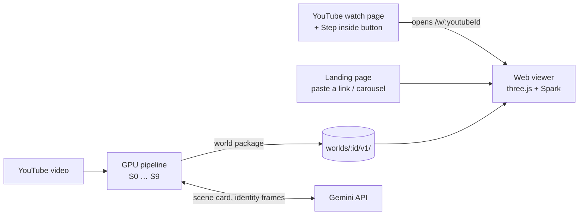

<p align="center">
  
</p>

<p align="center">
  <strong>Every video is a window. We turn it into a door.</strong><br>
  Built at Hack Western 13 as <em>Step Into the Video</em>.
</p>

---

# [Devpost](https://devpost.com/software/hackwestern13-project?ref_content=user-portfolio&ref_feature=in_progress), [Devpost Video](https://www.youtube.com/watch?v=JIDtutZ68RU)

## What is U splat?

U splat turns a YouTube video into a 3D place you can walk around in.

You're watching a video on YouTube. Next to the Like button is a **Step inside** button. Click it, and a new tab opens where the video has become a world: you're standing where the camera stood, the original video and its sound keep playing, and you can walk off the camera's path, look around, and walk around the people in it.

Everything you see in the world was rebuilt from what the camera actually filmed. We don't use generative AI to invent missing scenery. Where the camera never looked, the world simply ends; nothing is made up to fill it.

The name comes from **Gaussian splatting**, the 3D technique the worlds are built with: a scene is stored as millions of tiny coloured, semi-transparent blobs ("splats") that a browser can draw in real time.

## Contents

- [Try it](#try-it)
- [Inside a world](#inside-a-world)
- [How it works](#how-it-works)
- [The landing page](#the-landing-page)
- [The Chrome extension](#the-chrome-extension)
- [Getting worlds onto your machine](#getting-worlds-onto-your-machine)
- [Building a new world (GPU pipeline)](#building-a-new-world-gpu-pipeline)
- [Repo layout](#repo-layout)
- [Tech stack](#tech-stack)
- [Docs](#docs)
- [Licences and credits](#licences-and-credits)

## Try it

You need [Node.js](https://nodejs.org) 22 or newer (for Vite 8) and desktop Chrome. You don't need a GPU or any API keys to view worlds.

```bash
git clone https://github.com/ejo6/USplat-Engine.git
cd USplat-Engine/web
npm install
npm run dev
```

Then open:

- http://localhost:5173 for the landing page, with a carousel of the built worlds.
- http://localhost:5173/w/9lY7iZl1KbI to go straight into **Misty forest path**, the world that ships with the repo.

Other worlds are too big for git and are shared separately. See [Getting worlds onto your machine](#getting-worlds-onto-your-machine).

## Inside a world

A world opens in **ride-along**: the camera follows the original video's path, and the video plays framed inside its 3D surroundings. Click the page to take control:

- **Walk.** Move the mouse or press W, A, S or D, and the video fades away so you're standing in the scene at eye height (1.6 m). A walk boundary, built from what was filmed, slows you near the edge and slides you along it, so you can't walk out of the reconstructed area.
- **People.** People in the video become walk-around 3D avatars, rebuilt from a single photo of each person and animated with their real movements. Near the original camera you see their real video pixels instead, and the view blends between the two as you move away.
- **The timeline.** The seek bar works like YouTube's, with hover thumbnails. Grab it and the camera glides back to exactly where the original camera stood at that moment. Let go and playback continues in ride-along.
- **The original camera path.** The original camera's path can be drawn in the world, either in the air as it flew or flat on the floor, with the part already played lit up. Toggle it from the HUD with **Path: Off / Air / Floor**; it starts off.
- **Sound.** The original audio is the soundtrack. When you walk away from the camera, it becomes spatial and comes from where the camera was.
- **Playback speed.** 0.5×, 1×, 1.5× or 2×, from the speed button on the timeline.
- **Outside the rebuilt shot.** Only one continuous shot of each video is rebuilt. When the video plays a part outside it, the world gives way to the video on a floating panel.
- **HUD.** The scene title, a short scene description written by Gemini, a creator credit that is always visible, and a controls hint (the **?** button).

### Controls

| Input | Action |
|---|---|
| Click the world | Capture the mouse |
| Mouse | Look around |
| W A S D | Walk |
| Shift | Run |
| Space | Play / pause |
| ← / → | Back / forward 5 s |
| C | Rejoin the camera where it is right now (doesn't seek) |
| R | Restart the video from the beginning in ride-along |
| Esc | Release the mouse |

## How it works

U splat has three parts: a **Chrome extension** that adds the button, an offline **GPU pipeline** that turns a video into a world package, and a **web viewer** that plays the package in the browser.



### 1. The pipeline: video in, world out

The pipeline runs offline on a GPU, one stage at a time. Each stage reads the previous stages' output from `work/<id>/` and skips itself if its output already exists, so a failed run can pick up where it stopped.

| Stage | What it does | Main tools |
|---|---|---|
| **S0** Ingest | Normalises the clip to 1280×720 at 30 fps, makes the playback video and timeline thumbnails, extracts frames | yt-dlp, ffmpeg |
| **S1a** Shots | Finds the camera cuts and picks the best single continuous shot (60 s or less). Mixing two shots would corrupt the 3D solve. | PySceneDetect |
| **S1b** Director | Writes the scene card (title and description) and suggests what to segment besides people (animals, vehicles) | Gemini |
| **S2** Masks | Cuts out every person and moving object in every frame, with a stable ID per instance | SAM 3 |
| **S3** Cameras + depth | Recovers where the camera was and which way it pointed in every frame, plus depth | Depth Anything 3 |
| **S3b** World frame | Finds the floor and rescales everything so the floor is y = 0, up is +Y and units are metres | custom |
| **S4a / S4** Background | Fills the holes where people stood, then trains the Gaussian splat background with people masked out | LaMa, gsplat |
| **S5** Bounds | Works out which floor was actually seen and builds the walk boundary | custom |
| **S6a / S6b** Bodies | Tracks each person's 3D body pose per frame and places them in the world with their feet on the floor | GVHMR, SMPL-X |
| **S7a / S7** Avatars | Picks the clearest photo of each person and builds a 3D Gaussian avatar from it, rigged to the tracked motion | Gemini, LHM |
| **S8** People layer | Packs the people's real pixels and depth into a video, so they look exactly like the footage near the original camera | Video Depth Anything, ffmpeg |
| **S9a** Package | Writes the world package the viewer loads | Spark tools |

Gemini is optional everywhere: every Gemini call has a non-Gemini fallback, so a world can be built without it.

### 2. The world package

A world is a folder of static files, `worlds/<youtubeId>/v1/`, so a world opens with no server: just file reads. The main files:

| File | What it is |
|---|---|
| `manifest.json` | Entry point: title, credit, video info, shots and where every other file is |
| `video.mp4`, `thumbs.jpg/json` | The playback video and the timeline's hover thumbnails |
| `s0/world.rad` | The splat world, with level of detail so it streams in progressively |
| `s0/cameras.json` | The original camera's pose and lens for every frame |
| `s0/walk.json`, `s0/walk_sdf.bin` | The walkable area and boundary |
| `s0/people/…`, `s0/holo.mp4` | Avatars with their motion, and the real-pixel people layer |

The full format, including coordinate conventions, is in [docs/world-format.md](docs/world-format.md).

### 3. The viewer

The viewer (`web/`) is a Vite + TypeScript app using [three.js](https://threejs.org) and [Spark](https://sparkjs.dev) to render the splats. The original `<video>` element is the only clock: on every video frame, the camera path, avatars, people layer and HUD all update to that frame. So the world can never drift from the video, and seeking, pausing, looping and speed changes just work. The viewer picks its splat budget from your GPU (1.5M splats on Apple and integrated GPUs, 2.5M on discrete ones) to keep the frame rate up.

## The landing page

`/` is a Moraine Lake landing page. It has a field for a YouTube link, a rotating carousel of the built worlds, a short "how it works", and setup steps for the extension.

The demo doesn't process new videos live. Pasting a link to a world we've already built opens it. Any other valid link goes to `/unavailable`, which explains that the GPU cluster is unavailable and offers the built worlds instead. The carousel lists every world folder on your machine. Each one shows its 1280×720 YouTube cover, or a frame of its own video when it isn't a YouTube video.

## The Chrome extension

1. Run the web app (`cd web && npm run dev`).
2. Open `chrome://extensions` and turn on **Developer mode**.
3. Choose **Load unpacked** and select the repo's `extension/` folder.
4. Play any YouTube video and click **Step inside** next to Like.

The button opens `/w/<youtubeId>?t=<current time>` in a new tab. The viewer's address is set in [`extension/config.js`](extension/config.js) (`http://localhost:5173` by default). After changing the extension, click ↻ on its card in `chrome://extensions` and refresh YouTube. More in [docs/extension-setup.md](docs/extension-setup.md).

## Getting worlds onto your machine

World packages are 40–220 MB each, and anything committed to git stays in its history forever. So only **Misty forest path** (`9lY7iZl1KbI`) is committed. Every other folder under `worlds/` is git-ignored.

To get another world, copy its folder (for example `worlds/CThxyXWWqA0/`) from the GPU box or a teammate into `worlds/` at the repo root. `web/public/worlds` is a symlink to it, so the viewer finds it at `/w/<id>` right away.

| World | ID | In git |
|---|---|---|
| Misty forest path | `9lY7iZl1KbI` | yes |
| Modern living room | `2PBXchYQdao` | no |
| Dark hallway | `CEl6P5wo6ro` | no |
| Hilltop overlook (10 people) | `CThxyXWWqA0` | no |

A world shows up in the carousel as soon as its folder is in `worlds/`. Details are in [docs/demo-worlds.md](docs/demo-worlds.md).

## Building a new world (GPU pipeline)

Building a world needs an NVIDIA GPU with about 48 GB of memory. We used a RunPod A40, because Vultr's cloud GPUs were unavailable in every region. A 30 s clip takes roughly an hour.

1. **Set up the box** with one conda env per model family (`pipeline/envs/*.yml`) and the model weights. See [docs/gpu-setup.md](docs/gpu-setup.md).
2. **Add keys.** Copy `.env.example` to `.env` and fill in only what you need (`GEMINI_API_KEY`, `HF_TOKEN`, …). Never commit `.env`.
3. **Download the clip on your laptop.** YouTube blocks the GPU box. Keep it to 60 s or less of one continuous shot; 15–40 s works best.
4. **Run the pipeline:**

   ```bash
   python pipeline/run.py --youtube-id <id> --stages S0..S9 [--window a,b] [--force]
   ```

   Intermediate output goes to `work/<id>/` (git-ignored). The finished package goes to `worlds/<id>/v1/`.
5. **Copy the world** to your laptop's `worlds/`. It appears in the carousel on refresh.

The step-by-step guide, from a YouTube link to a world you can walk in, is [docs/youtube-to-world.md](docs/youtube-to-world.md). Each stage's inputs, outputs and skip logic are in [docs/pipeline-runner.md](docs/pipeline-runner.md).

## Repo layout

| Path | Contents |
|---|---|
| `extension/` | Chrome MV3 extension: the Step inside button (`content.js`, `content.css`, `config.js`) |
| `web/` | Landing page and viewer (Vite + TypeScript + three.js + Spark) |
| `web/src/people/` | Avatars, the real-pixel people layer and the blend between them |
| `pipeline/` | Stage scripts `s0_ingest.py` … `s9_package.py`, the runner `run.py`, conda envs in `envs/`, tests in `tests/` |
| `config/` | `gemini.yaml`: the pinned Gemini model and prompts |
| `server/` | Placeholder for the job API and GPU worker (planned, not built) |
| `worlds/` | World packages; only `9lY7iZl1KbI` is committed |
| `work/` | Pipeline scratch output (git-ignored) |
| `docs/` | Product spec, formats, pipeline internals, setup guides |

## Tech stack

| Area | Tools |
|---|---|
| Extension | Chrome Manifest V3, plain JavaScript |
| Web | Vite, TypeScript, three.js, Spark (Gaussian splat rendering), Web Audio |
| Ingest | yt-dlp, ffmpeg, PySceneDetect |
| AI director | Google Gemini (scene cards, segmentation hints, identity frames) |
| Segmentation | SAM 3 |
| 3D reconstruction | Depth Anything 3, gsplat, LaMa |
| People | GVHMR, SMPL-X, LHM, Video Depth Anything |
| Compute | RunPod A40 (48 GB), Vultr |

## Docs

| Doc | Read it for |
|---|---|
| [docs/prd.md](docs/prd.md) | The product spec: scope, decisions, architecture and the contracts between parts |
| [docs/world-format.md](docs/world-format.md) | The world package format |
| [docs/demo-worlds.md](docs/demo-worlds.md) | Which worlds exist and how they're shared |
| [docs/youtube-to-world.md](docs/youtube-to-world.md) | Building a world by hand on the GPU box |
| [docs/pipeline-runner.md](docs/pipeline-runner.md) | Pipeline stages, skip logic and the stage contract |
| [docs/recon-pipeline.md](docs/recon-pipeline.md) | Cameras, depth, splat training and bounds |
| [docs/people-pipeline.md](docs/people-pipeline.md) | Masks, bodies, avatars and the people layer |
| [docs/gemini-director.md](docs/gemini-director.md), [docs/gemini-setup.md](docs/gemini-setup.md) | How Gemini is used, and setup |
| [docs/gpu-setup.md](docs/gpu-setup.md), [docs/gpu-ledger.md](docs/gpu-ledger.md) | GPU box setup and spend |
| [docs/extension-setup.md](docs/extension-setup.md) | Installing and configuring the extension |

## Licences and credits

This is a non-commercial hackathon demo. Some of the models it uses are licensed for research only: Depth Anything 3 Large/Giant weights and Pi3X (CC BY-NC), and SMPL/SMPL-X (non-commercial). SAM 3 is under Meta's own licence. gsplat, Spark, LHM's code and yt-dlp are permissively licensed. Details are in [PRD §17](docs/prd.md#17-licences).

The landing page photo is *Moraine Lake at 6AM* by [Redd Francisco](https://unsplash.com/@reddfrancisco) on Unsplash.
