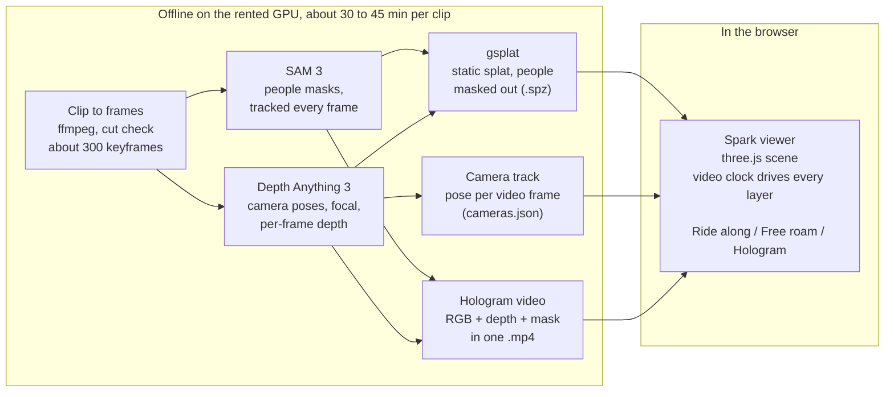

# Step Into the Video — Hackathon PRD

Nov 20, 2026

## Summary

We turn a short adventure clip into a place you can walk around in while the original video plays inside it. The scene itself is a static 3D Gaussian splat built from the clip's frames. The video's own moment-by-moment content (the climbers, the host, the camera operator's path) is layered back into that space in sync with playback.

The key design choice: we do not try to reconstruct a moving 4D scene. The background is frozen and built once; motion comes from the video itself, placed in 3D at the exact spot and angle the camera filmed it from. That keeps the hard ML problem to one that open-source tools already solve well, and puts our effort into the experience.

- **Category:** Adventure. Demo clips are summits, ridgelines, caves, canyons and big-stunt sets.
- **Deliverable for Sunday:** a web viewer with 3 or 4 precomputed scenes, built Saturday night.
- **Hardware:** team Macs (Apple Silicon) for app work and light ML; one rented NVIDIA GPU for the heavy steps.
- **Note:** the hackathon's own description wasn't attached, so judging criteria below are assumed. Paste them in and we'll align the success criteria.

## Goals, non-goals and success criteria

The demo wins if a judge presses play, walks off the camera's path, and still feels like they are standing on the mountain while the climb happens.

**Goals**

1. Reconstruct the place in a clip as a clean, explorable splat, with people removed from the static scene.
2. Play the original video in sync inside that 3D scene, anchored to where the camera really was.
3. Show the people in the video as depth "holograms" that move through the reconstructed space.
4. Let the viewer walk freely, or ride along on the original camera path.
5. Ship 3 or 4 polished adventure scenes that load in under 10 s in a browser.

**Non-goals**

- Full 4D dynamic reconstruction of the moving scene.
- Live, on-stage processing of a new video. A pipeline run is shown as a recording or a progress view.
- Accounts, uploads, sharing or a backend beyond static file hosting.
- Clips with hard cuts. Each scene comes from one continuous shot.

**Success criteria for Sunday**

| Criterion | Target |
| --- | --- |
| Scenes ready | 3 minimum, 4 stretch |
| Viewer frame rate on a MacBook | 60 fps with video playing |
| Sync between video and 3D camera path | Visually locked, no drift over the clip |
| Free-roam range before splat breaks down | About 1 to 2 m off the camera path |
| Pipeline per clip on a rented GPU | Under 45 min end to end |
| Demo script length | 3 minutes, with a recorded fallback video |

## User experience

The viewer opens on the scene paused at frame 0, with the original camera's path drawn as a faint line through the 3D space. Pressing play starts the video, its audio and every 3D layer on one shared clock.

**Three ways to watch, switchable with one key:**

1. **Ride along (default).** The viewer's camera follows the original camera path. The video frame fills the centre of the screen; turning your head past its edges reveals the reconstructed world around it. This is the money shot: the clip suddenly has a 360-degree surrounding.
2. **Free roam.** WASD and mouse to walk anywhere. The video keeps playing as a floating screen at the exact position and angle it was filmed from, so you can watch the camera operator "walk" through the scene from the side.
3. **Hologram.** The people in the clip are lifted out of each frame into 3D using per-frame depth. They move through the splat in sync with the video, and you can walk around them. Viewed side-on they look like thick cut-outs, which reads as a stylised hologram rather than a bug.

**Controls and touches**

- Timeline scrubber; clicking a point on the 3D camera path jumps to that moment.
- "Snap back" button returns you to the camera path, plus a soft boundary that fades the view when you stray too far.
- Spatial audio: the clip's sound plays from the camera's position in the scene (Web Audio panner).
- Scene picker with 3 or 4 adventure scenes and a short title card each.
- Optional: WebXR so a judge can try it in a Quest headset, since Spark renders in WebXR.

## Technical architecture

The pipeline runs once per clip, offline, and writes four files that a static web viewer plays back. Depth Anything 3 is the hub: its poses train the splat, drive the camera track and place the holograms, so every layer shares one coordinate frame.

Masks and DA3 output feed all three products; the viewer reads them and keeps them in sync off the video's own clock.

**Pipeline steps**

1. **Ingest.** Trim the clip, reject it if PySceneDetect finds a cut, and keep every frame for playback. Pull keyframes at 3 to 5 fps for reconstruction, downscaled to about 1280 to 1600 px on the long edge.
2. **Masks.** Run SAM 3 with prompts like "person", "climber", "backpack". Dilate masks by about 10 px so edges don't leak into the splat.
3. **Geometry.** Run DA3 (Nested model) on the keyframes for poses, intrinsics and depth, and export COLMAP format. For hologram depth on every playback frame, run DA3 conditioned on those poses at lower resolution, or Video Depth Anything scaled to match.
4. **Splat.** Train gsplat for 30k steps on the keyframes with masks, world-space normalisation off. Export PLY, compress to SPZ.
5. **Camera track.** Interpolate keyframe poses to every video frame (slerp rotation, lerp position) and write cameras.json.
6. **Hologram video.** Tile each frame's RGB, depth and person mask side by side into one 720p H.264 video.
7. **Viewer.** Spark renders the splat. A three.js plane shows the video at the current camera pose. A grid mesh (about 256 by 144 vertices) is pushed out by the depth texture in a vertex shader, placed at the same pose, and clipped by the mask, which gives the hologram. A requestVideoFrameCallback loop updates all of it each frame.

**Per-scene output (the contract between pipeline and viewer)**

| File | Contents |
| --- | --- |
| scene.spz | Static splat, people removed |
| video.mp4 | Original clip with audio |
| holo.mp4 | RGB, depth and mask tiles per frame |
| cameras.json | fps, intrinsics, and a position and rotation per frame |
| meta.json | Title, start pose, walkable bounds |

Because the contract is fixed on Friday night, the viewer team can build against a hand-made test scene while the pipeline is still being debugged.

## Tooling

Every piece we need exists as open-source code today; the main split is which ones need NVIDIA CUDA and which run on our Macs.

| Tool | Job in our pipeline | Runs on Apple Silicon? | License and notes |
| --- | --- | --- | --- |
| yt-dlp, ffmpeg, PySceneDetect | Get the clip, trim it, extract frames, reject shots with cuts | Yes | Use Creative Commons or our own footage for the demo |
| [Depth Anything 3](https://github.com/ByteDance-Seed/Depth-Anything-3) | **Core.** Camera pose and intrinsics for every frame, plus per-frame depth, all in one consistent world frame. Exports COLMAP format. DA3-Streaming handles longer clips | Yes, via MPS (slower). An [MPS-tuned fork](https://pypi.org/project/awesome-depth-anything-3/) exists | Code Apache 2.0; the best "Nested" model is [CC BY-NC 4.0](https://pypi.org/project/depth-anything-3/0.1.0/), which is fine for a hackathon |
| [SAM 3](https://ai.meta.com/sam3/) | Masks and tracks every "person" (or "climber", "rope") across the clip from a text prompt | Effectively CUDA only; or [fal.ai's hosted API](https://fal.ai/models/fal-ai/sam-3/video) at about $0.31 per 1,000 frames | Meta model licence. Masks feed both training and holograms |
| [gsplat](https://github.com/nerfstudio-project/gsplat) | Trains the static splat on the rented GPU | No (CUDA) | Apache 2.0. Supports masks in training |
| [Brush](https://github.com/ArthurBrussee/brush) | Trains the splat on a Mac; also our quick-look tool | Yes (Metal via WebGPU) | Apache 2.0. Takes COLMAP input and a [masks folder or alpha images](https://radiancefields.com/brush-0-2-released) |
| [Video Depth Anything](https://arxiv.org/abs/2501.12375) | Backup depth for holograms if DA3 depth flickers frame to frame | Small model is light enough for a Mac | Temporally stable depth for long videos |
| [VGGT](https://github.com/facebookresearch/vggt), [MegaSaM](https://mega-sam.github.io) | Backup pose estimators. MegaSaM is built for handheld, dynamic, low-parallax clips | No (CUDA) | Use only if DA3 poses look wrong |
| [Spark 2](https://sparkjs.dev) + three.js r180+ | The web viewer: splats and normal meshes in one scene, WebXR, streamed level of detail | Yes, any browser | MIT. Video textures and hologram meshes are ordinary three.js objects |
| [GVHMR](https://zju3dv.github.io/gvhmr) | Stretch: full 3D body meshes of people in world coordinates | No (CUDA) | Fast: 280 ms for a 1,430-frame clip on an RTX 4090, after preprocessing |
| World Labs Marble API | Fallback world if a clip won't reconstruct | Cloud API | About $1.20 per world; judges may see it as "just an API" |

## Compute plan

Rent one RTX 4090 on RunPod for the weekend; the whole GPU bill should land around $5 to $15, under a $25 cap.

**Why rent at all:** SAM 3, gsplat and the CUDA-only backups don't run on Macs, and Mac splat training is several times slower. The Macs stay useful for DA3 tests, Brush quick looks and all viewer work.

| Provider | GPU | Price per hour | Billing | Fit |
| --- | --- | --- | --- | --- |
| [RunPod](https://www.runpod.io/gpu-cloud/pricing) Community | RTX 4090, 24 GB | $0.34 | Per second | **Pick this.** Cheapest reliable option; 24 GB is plenty for gsplat and DA3 |
| [RunPod](https://www.runpod.io/gpu-instance/rtx-4090) Secure | RTX 4090, 24 GB | $0.69 | Per second | Upgrade if community hosts are flaky |
| [Vast.ai](https://markaicode.com/pricing/vast-ai-pricing/) | RTX 4090, 24 GB | $0.27 floor, $0.50 median | Per second | Cheaper but hosts vary in reliability |
| [RunPod](https://runpod.io/gpu-cloud) | A100 80 GB | $1.79 | Per second | Only if the giant DA3 model runs out of memory on 24 GB |
| [Modal](https://modal.com/pricing) | L40S, 48 GB | $1.95 | Per second, serverless | Starter plan includes $30 a month of free credit; good if we script the pipeline as Python functions |

**Per-clip GPU time on a 4090 (estimates, confirm on clip 1):**

- DA3 poses and depth on about 300 frames: 2 to 5 min
- SAM 3 masks: 2 to 5 min
- gsplat training, 30k steps: 10 to 25 min
- Hologram depth and video packing: under 5 min

That is about 30 to 45 min per clip. Six candidate clips (to keep the best four) is about 4 to 5 GPU hours, plus 6 to 8 hours of setup and debugging: roughly 12 hours, or about $4 at the community rate and $8 on Secure Cloud.

**Setup tips:** start from RunPod's PyTorch CUDA template, attach a persistent volume so models and results survive a restart, pin gsplat and torch versions, and stop the pod whenever no one is using it.

## Demo content

Clip choice decides the demo more than any model does, so we pick six candidates tonight and keep the four that reconstruct best.

**A clip qualifies if it has:**

- 10 to 30 s of one continuous shot, at 1080p or better
- A camera that walks or orbits, not one that only pans or zooms
- A mostly static background, with people covering less than about a third of the frame
- Even daylight, little motion blur, and ideally a 360-degree sweep somewhere in the shot

| Scene type | Why it works | Main risk |
| --- | --- | --- |
| Ridge or summit walk, helmet cam | Big parallax, rock and snow texture, climbers ahead to lift as holograms | Snow glare and sky can produce floaters |
| Slot canyon or cave walk | Close walls give strong geometry; very "step inside" | Low light and noise |
| Waterfall or glacier approach on foot | Wow factor; people small in frame | Moving water won't reconstruct; it blurs into a static sheet |
| Stunt or challenge set (the MrBeast-style room) | Indoor, textured, lots of camera movement | Usually heavy cutting and copyrighted |
| Our own footage, shot Saturday morning | Guaranteed rights and a slow 360 sweep on purpose | Less dramatic, so film somewhere scenic |

**Sources:** YouTube's Creative Commons filter, Wikimedia Commons and free stock video sites, plus our own phone or GoPro footage. Downloading from YouTube with yt-dlp breaks its terms, and a famous creator's video is copyrighted, so keep those for the pitch narrative and screen only clips we have rights to.

Shooting one clip ourselves is cheap insurance: a slow walk with a full turn in the middle, one teammate walking through the shot for the hologram layer.

## Timeline and team

Tonight's only job is to push one clip all the way through, even by hand; Saturday noon is the go/no-go on the custom pipeline.

| Phase | When | Work | Gate at the end |
| --- | --- | --- | --- |
| Prove one clip | Fri, now to 2 am | Pick 6 clips; DA3 test on a Mac; rent the GPU; freeze file format | One clip works end to end |
| Core pipeline | Sat, 9 am to noon | SAM 3 + gsplat scripted; video plane in sync; camera track | **Go/no-go: splat and camera path line up** |
| Holograms | Sat, noon to 6 pm | Depth shader; ride-along mode; scene picker, UI | Feature freeze (Sat 6 pm) |
| Batch scenes | Sat, 6 pm to 1 am | Run 6 clips on GPU; keep the best 4; compress, tune | Four scenes final (Sun 1 am) |
| Rehearse | Sun morning | Record backup run; pitch 3 times; serve locally | — |

If the go/no-go fails, drop holograms, keep ride-along and free roam, and fill weak scenes with Marble worlds.

| Person | Owns | Works on |
| --- | --- | --- |
| A | Ingest and masks: trimming, cut check, SAM 3, clip curation, shooting our own clip | Mac, plus GPU box for SAM 3 |
| B | Reconstruction: DA3, gsplat, cameras.json, the alignment test; owns the GPU box and budget | GPU box |
| C | Viewer core: Spark scene, video plane, camera track, ride-along and free-roam controls | Mac |
| D | Holograms and story: depth packing, hologram shader, UI polish, pitch and backup video | Mac |

## Risks, fallbacks and open questions

The riskiest piece is not the ML; it's getting the splat, the camera path and the holograms to agree on one coordinate frame, so we test that first.

| Risk | Mitigation | Fallback |
| --- | --- | --- |
| Splat and camera path don't line up | Turn off gsplat's world-space normalisation, or save its transform and apply it to the cameras file. First test: draw frame 0 at its camera pose over the splat | Hand-tune one offset per scene in the viewer |
| A clip won't reconstruct | Six candidates; DA3 check on a Mac tonight before any GPU time | VGGT or MegaSaM poses; then a Marble world for that scene |
| Hologram depth is the wrong scale | Take depth from the same DA3 run as the poses so the scale matches | Scale each frame's depth to match the splat's rendered depth |
| Floaters from people, sky or water | SAM 3 masks for people; sky mask from DA3; crop the scene's bounding box | Clean up in SuperSplat by hand |
| Video and 3D drift apart | Drive every layer from the video element's clock; interpolate poses between keyframes | Ride-along mode only |
| Viewer stutters | Compress splats to SPZ, cap around 1.5 million splats, 1080p H.264 video | Lower splat budget per scene |
| CUDA setup eats Saturday | One person owns the GPU box; pinned versions; RunPod PyTorch template | Train on Macs with Brush; accept fewer scenes |
| Live demo fails on stage | Serve everything locally from a laptop | Recorded 3-minute walkthrough video |

**Open questions**

- [ ] What does the hackathon description say about judging criteria and the Adventure category? Paste it in and we'll tune the goals.
- [ ] Do we have rights to at least three adventure clips, or are we filming one ourselves?
- [ ] Does anyone have a Quest headset for a WebXR moment?
- [ ] Who owns the GPU box and the $25 budget?

## Sources

- [Depth Anything 3 repository](https://github.com/ByteDance-Seed/Depth-Anything-3) and [model licences](https://pypi.org/project/depth-anything-3/0.1.0/)
- [SAM 3 (Meta)](https://ai.meta.com/sam3/) and [fal.ai SAM 3 video pricing](https://fal.ai/models/fal-ai/sam-3/video)
- [gsplat](https://github.com/nerfstudio-project/gsplat), [Brush](https://github.com/ArthurBrussee/brush), [Brush 0.2 masks support](https://radiancefields.com/brush-0-2-released)
- [Spark docs](https://sparkjs.dev/docs/overview/) and [Spark on Radiance Fields](https://radiancefields.com/platforms/spark)
- [Video Depth Anything](https://arxiv.org/abs/2501.12375), [MegaSaM](https://mega-sam.github.io), [GVHMR](https://arxiv.org/abs/2409.06662)
- [RunPod pricing](https://www.runpod.io/gpu-cloud/pricing), [Modal pricing](https://modal.com/pricing), [Vast.ai prices, Nov 16 2026](https://markaicode.com/pricing/vast-ai-pricing/)