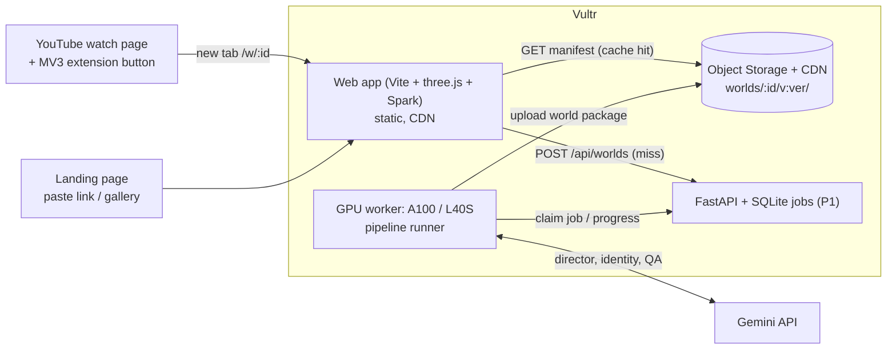

# PRD: Step Into the Video (Hack Western 13)

Version 2.0, Nov 21, 2026. This replaces prd.md v1 (Nov 20).

> **For agents:** read this file before every task. It is the source of truth for scope, decisions and the contracts between components. Tasks, status and day-to-day changes live in Jira (project `KAN`), not here. If the PRD and the Jira ticket don't answer something, stop and ask a human. To change a contract (§8, §9), open a PR that edits this file and tag the owners of every component that reads it.

---

## 1. Product

**One-liner:** *Every video is a window. We turn it into a door.*

On any YouTube watch page, a **Step inside** button sits next to Like. Clicking it opens a new tab where the video becomes a place. You walk around inside it and around the people in it while the original video and audio play. Everything the camera saw is solid world. Everything it never saw is fog, because we don't invent what wasn't filmed.

**Prize targets and pitch angles**

| Prize | Angle |
|---|---|
| Organizers' Choice: Most Adventurous ("enables others to discover the unknown"), **primary** | The fog is the unknown, made literal. Scrubbing the timeline pulls you back to exactly what the camera saw. |
| 1st–3rd Overall (Innovation, Technical Complexity, Completeness, Design) | Shot detection, monocular reconstruction, Gaussian splatting, animated human avatars, a coverage-bounded world and a synchronized 4D web player, all built on open models. |
| MLH Best Use of Gemini API | Gemini directs the pipeline: it picks shots, writes the segmentation prompts, chooses the avatar identity frame, quality-checks renders and writes the scene card (§7.3). |
| MLH Best Use of Vultr | The GPU worker, object storage/CDN and API host run on Vultr. |
| Canada Life Future Me (optional, P2) | A "Future Me" mode: walk inside a place you're saving toward, with a Gemini goal card. Only if the core is finished; the odds are low. |

**Engagement story:** creators get "step into my video." Viewers rewatch spatially. The cache is global, so each world is computed once and every later viewer costs one CDN read. A production version would be opt-in for creators.

---

## 2. Scope

**Priorities.** P0 must ship for the demo. P1 is in scope and gets built once P0 works end to end. P2 is a stretch.

**In scope**

- Chrome MV3 extension with a button next to Like (P0).
- Landing page where you paste a YouTube link, plus a gallery of demo worlds (P0).
- Global world cache. No accounts (P0).
- Offline GPU pipeline that turns a YouTube video into a world package (§8) (P0, run manually from the CLI).
- Job API, GPU worker and progress screen so uncached videos get processed automatically (P1).
- Viewer (P0):
  - static splat world;
  - original video and audio as the master clock;
  - walk mode and ride-along mode;
  - YouTube-style timeline whose scrubbing returns you to the original camera;
  - fog over unseen space and a walk boundary;
  - people as animated 3D avatars blended with real video pixels.
- Scene cuts: one world per video from its longest usable shot (P0). One world per shot with a fog crossfade (P1).
- Optional Gemini scene cards and segmentation hints (P0), plus a quality gate (P1). The demo must bake without Gemini.

**Non-goals**

- VR/WebXR, mobile, touch.
- Accounts, login, MP4 upload, platforms other than YouTube.
- Generative novel-view models (Stable Virtual Camera, GeoNVS, GEN3C, Lyra). Orbis tried all four and got invented courtyards, grey mush, gibberish signs and slow scenes.
- Refining body poses against the footage. One camera can't recover limb depth, and it made Orbis's avatars worse.
- Mesh-from-image humans (V-DPM, PIFuHD). They produce melted limbs.
- Object labels, talking to characters, picking up objects.
- Processing a new video live on stage. Judges only see pre-baked worlds.

**Stretch (P2):** playback speed control, spatial audio, mini-map, the World Labs Atlas room-fill experiment (S4b), multi-shot location merging, Canada Life mode, and processing full-length videos beyond the 60 s window.

---

## 3. Locked decisions

| Topic | Decision | Why |
|---|---|---|
| Accounts | None. Anonymous only. | Not needed. Avoids Auth0 work. |
| Cache | Global, keyed by `{youtubeId, pipelineVersion}`. A cache hit opens instantly for anyone. | Compute once, serve from the CDN. |
| People | **Hybrid** (§10.5). An LHM Gaussian avatar per tracked person, driven by per-frame body motion, plus a real-pixel "people layer" (masked RGB + depth). The view blends from real pixels near the original camera to the avatar off-axis. | A depth video alone has no back, so you can't walk around it. Avatars alone lose the real face. Orbis shipped avatars. |
| Unseen space | **No generated fill in the default path.** The viewer's fog volume is removed (KAN-84): unseen space shows as-is. | Fill means invention. Orbis rejected Marble outputs for invented fixtures and a warped bench. Fog matches the "discover the unknown" theme. |
| World Labs Atlas | **Optional fill stage S4b, run by hand on hero clips** (no fixed spend cap; log spend in the ledger). Uses Atlas `posedImages2Splats` with our own cameras, depth and masks, so the result lands in our world frame with no alignment. | It invents content where the video never looked, so generated splats are kept only outside the observed area and are marked for tinting. The legacy Marble API is not used: Atlas keys don't work on it. |
| Scene cuts | P0: reconstruct only the **longest usable single shot**. P1: one world per shot, fog crossfade at each cut. | Ignoring cuts doesn't just look stagnant, it **corrupts** the result. The pose solver forces two places into one frame, giving ghost double-exposed geometry, a teleporting camera and a splat that matches neither shot. |
| Video length | Any URL is accepted. The MVP processes a window of **60 s or less**. If the video is longer, Gemini picks the highlight window. Full length is P2. | Compute: about 45–80 GPU-min per 60 s (estimate). |
| Scrubbing | When you grab the seek bar, the camera glides back to the original camera pose and follows the original path while you drag. On release, playback resumes in ride-along until you move (§10.3). | The original viewpoint is the one place where everything is guaranteed correct. |
| Platform | Desktop Chrome, keyboard and mouse. An M1 MacBook Air is the minimum. The client only renders; all heavy compute is offline. | Judges' laptops. |
| Demo clips | 30–60 s, single shot: scenery, nature, simple vlogs with 1–3 people. Only our own, CC-licensed or creator-permitted videos, credited on screen. | Quality, plus YouTube ToS (§12). |
| Compute | Vultr GPU (A100 80 GB or L40S 48 GB) first, RunPod A100 as fallback. Macs for viewer work and light tests. | Vultr prize; we're willing to rent an A100. |

---

## 4. User flows

**4.1 From YouTube (primary)**

1. The user watches a video and clicks **Step inside** next to Like.
2. A new tab opens `https://<site>/w/<youtubeId>?t=<currentTime>`.
3. The viewer tries the cache (`manifest.json` on the CDN).
   - **Hit:** the world loads and the user starts in ride-along at the start of the processed window.
   - **Miss:** the viewer calls `POST /api/worlds` and shows the progress screen (stage, percentage, ETA, scene card, or a failure reason). When the job is done, the world loads automatically. (P1. In the P0 fallback the screen says "Not processed yet".)

**4.2 From the landing page:** paste a YouTube link to go to `/w/<youtubeId>` (same flow), or click a world in the demo gallery.

**4.3 In the viewer**

1. The world opens in ride-along: the camera follows the original path and the video plays framed inside its 3D surroundings.
2. Click to capture the mouse. Moving the mouse or pressing WASD switches to walk mode at eye height, and the people become walk-around avatars.
3. Walk toward the edge of what was filmed: the world dissolves into fog and movement softly slows and slides along the boundary.
4. Grab the timeline: the camera glides back to the original camera and follows the video's own path while you drag. Release to keep playing in ride-along. Move to walk off again.
5. Press **C** to rejoin the camera without seeking, or **R** to restart from the beginning. Press **F** to toggle the fog (demo comparison).

---

## 5. Functional requirements

Areas: EXT = extension, WEB = landing page, API, PIPE = pipeline, VIEW = viewer, PPL = people, GEM = Gemini.

| ID | Requirement | Pri | Area |
|---|---|---|---|
| FR-01 | Extension injects a **Step inside** button next to the Like button on `youtube.com/watch` pages. It survives YouTube's single-page navigation (`yt-navigate-finish`, `MutationObserver`), is inserted at most once, and still finds Like when selectors change (fall back to the like button's `aria-label`). | P0 | EXT |
| FR-02 | Clicking the button opens `/w/<youtubeId>?t=<currentTime>` in a new tab. No remote code (MV3 rule). | P0 | EXT |
| FR-03 | The landing page accepts any YouTube URL format (watch, youtu.be, shorts) and routes to `/w/<youtubeId>`. Invalid input shows an inline error. | P0 | WEB |
| FR-04 | The landing page shows a gallery of the demo worlds, each with a title, thumbnail and creator credit. | P0 | WEB |
| FR-05 | The viewer resolves a world from the static CDN path `worlds/<youtubeId>/v<pipelineVersion>/manifest.json` with no API call (the cache-hit path). | P0 | VIEW |
| FR-06 | `POST /api/worlds` dedupes on the cache key: it returns the ready manifest, the existing job, or a new queued job. | P1 | API |
| FR-07 | A job reports `status`, `stage`, `pct`, `etaSeconds`, `sceneCard` and `error` (§9). The viewer shows them on a progress screen and opens the world when it's ready. | P1 | API/VIEW |
| FR-08 | Every failure carries a readable reason from the enum in §9. | P1 | API |
| FR-09 | The pipeline runs as an idempotent CLI. Each stage skips if its outputs already exist and are valid. Stages emit progress events. | P0 | PIPE |
| FR-10 | The pipeline detects shot cuts. For P0 it selects the longest usable shot of 60 s or less. For longer sources, S0 processes the supplied window or the first 60 seconds. | P0 | PIPE/GEM |
| FR-11 | The pipeline outputs a world package that matches §8 exactly. | P0 | PIPE |
| FR-12 | The background splat excludes all masked movers from **both** the RGB and the depth losses. | P0 | PIPE |
| FR-13 | Every tracked person gets an avatar, a per-frame motion track in world space with feet on the floor, and visible-frame ranges. | P0 | PPL |
| FR-14 | Every masked mover (people, animals, vehicles) appears in the people layer video (real pixels plus depth). | P0 | PPL |
| FR-15 | The `<video>` element is the master clock. The camera path, avatars and people layer are all within 1 frame of `video.currentTime`. | P0 | VIEW |
| FR-16 | Ride-along mode: the camera follows the original pose per frame with the original FOV, and the video overlay is aligned with the world. | P0 | VIEW |
| FR-17 | Walk mode: pointer lock, WASD, mouse look, Shift to run, eye height 1.6 m above the floor, colliders. | P0 | VIEW |
| FR-18 | **R** returns to the original camera without seeking. Any movement input leaves ride-along. **C** toggles ride-along. | P0 | VIEW |
| FR-19 | YouTube-style transport controls: seek bar with hover thumbnails, play/pause (Space and button), ±5 s (arrow keys), time display, loop at the end. | P0 | VIEW |
| FR-20 | Scrubbing behaves as specified in §10.3. | P0 | VIEW |
| FR-21 | Fog over low-coverage space, with no full-screen darkening and an **F** toggle (§10.4). | P0 | VIEW |
| FR-22 | Walk boundary from the walk SDF: slow down in the margin, slide along the edge, never pass through it (§10.4). | P0 | VIEW |
| FR-23 | People render as described in §10.5: avatars hold their last pose at loop or end, never interpolate across a seek, and cast contact shadows. | P0 | VIEW/PPL |
| FR-24 | View-dependent blend between the people layer and the avatars. | P1 | VIEW/PPL |
| FR-25 | When `t` is outside the reconstructed shot, show the video on a panel in fog (P0). Multi-shot worlds crossfade through fog at cuts (P1). | P0/P1 | VIEW |
| FR-26 | HUD with a controls hint, scene title, Gemini scene card and **creator credit** (always visible in a corner). | P0 | VIEW |
| FR-27 | The director produces `director.json` with the S1a window, a baseline person prompt, and a scene card. Gemini can enrich the card and add optional animal and vehicle hints. | P0 | GEM |
| FR-28 | Gemini picks each person's identity frame (clearest front-facing, unoccluded view, cropped inside that person's mask). | P0 | GEM/PPL |
| FR-29 | The Gemini quality gate compares 6–8 rendered views with the source frames and writes `qa` into the manifest (pass, warn or fail, plus notes, plus a suggested fog radius). | P1 | GEM |
| FR-30 | Ghost line showing the original camera path in walk mode. | P1 | VIEW |
| FR-31 | Extension shows a "ready" badge when the video is already cached. | P2 | EXT |
| FR-32 | Playback speed (0.5×–2×), spatial audio, mini-map (**M**). | P2 | VIEW |

---

## 6. Non-functional requirements

All of these are targets; measure them.

| ID | Requirement |
|---|---|
| NFR-01 | Demo world: first interactive frame in 3 s or less, full detail in 10 s or less on venue Wi-Fi with a pre-warmed cache, and 1 s or less from the local bundle. |
| NFR-02 | Frame rate with the video playing, fog on and up to 3 avatars: 45 fps or more on an M1/M2 Air at 1440×900, 30 fps or more on Intel/AMD integrated GPUs, 60 fps or more on discrete GPUs. |
| NFR-03 | Sync: avatar, people layer and camera pose within 1 frame of the video's media time. No visible drift over 60 s. |
| NFR-04 | Seeking: the overlay appears within 100 ms of starting a drag, and playback resumes within 500 ms of release. |
| NFR-05 | World package of 100 MB or less per 60 s, streamed progressively. |
| NFR-06 | Pipeline: 90 min or less per 60 s single-shot clip with 3 or fewer people on one A100/L40S. |
| NFR-07 | Cost: $5 or less of GPU per 60 s world. Paid APIs cost $0 by default. |
| NFR-08 | No secrets in git or in the extension bundle. The extension asks for only the permissions it needs. |

---

## 7. Architecture

### 7.1 System



### 7.2 Pipeline stages

These are for one 60 s, 720p, 30 fps single-shot clip with 3 or fewer people on one A100. All times are estimates; measure them on the first clip. Each stage reads and writes `work/<youtubeId>/<stage>/`.

| Stage | What it does | Tools | Main outputs | Est. time | Owner |
|---|---|---|---|---|---|
| S0 Ingest | Download (window only), normalize to 1280×720 at 30 fps, playback encode with a short GOP, thumbnail sprite, extract frames | yt-dlp (+ Deno, PO-token plugin), ffmpeg | `source.mp4`, `video.mp4`, `frames/`, `thumbs.jpg/json` | 1–3 min | Kevin |
| S1 Shots + Director | Cut detection and default shot selection, then optional Gemini scene card and extra segmentation hints | PySceneDetect (content detector), Gemini | `shots.json`, `director.json` | 1–2 min | Kevin |
| S2 Masks | Per-instance video masks and IDs from Gemini prompts (fallback prompt "person"). Union mask dilated 10–20 px. | SAM 3 | `masks/<instance>/`, `masks/union/`, `tracks.json` | 5–10 min | Adam |
| S3 Cameras + Depth | Poses, intrinsics and depth on keyframes at 5 fps (about 300), then interpolate to every frame (slerp rotation, lerp position) | Depth Anything 3 (Pi3X fallback) | raw cameras, keyframe depth | 2–5 min | Eric |
| S3b World frame | Fit the floor plane, then transform everything so the floor is y = 0, +Y is up, units are metres. Convert to three.js camera convention. | custom | `cameras.json`, `world_transform.json` | <1 min | Eric |
| S4 Background | 3DGS training on keyframes, masked RGB + depth losses, about 30k steps | gsplat (Brush fallback), LaMa (P1, for holes behind people) | `world.ply` | 15–30 min | Eric |
| S5 Bounds | Coverage voxels, walk SDF, colliders, fog colour | custom | `coverage.bin`, `walk_sdf.bin`, `walk.json`, `colliders.glb` | 1–2 min | Eric |
| S6 Body tracking | Per-person body parameters per frame, matched one-to-one to SAM instances and smoothed, then placed in the world frame: scale from body height + floor, feet pinned | GVHMR or Multi-HMR (spike), SMPL-X | `people/<pid>/motion.bin`, `visible` | 5–10 min | Adam |
| S7 Avatars | Gemini identity frame, then LHM avatar, exported in the format chosen in the rendering spike | LHM-500M/1B (LHM++ if multi-image helps) | `people/<pid>/avatar.*`, `skin.bin` | <1 min per person | Adam |
| S8 People layer | Per-frame depth scaled to DA3, then pack RGB + inverse depth + mask | Video Depth Anything, ffmpeg | `holo.mp4`, `holo.json` | 1–2 min | Adam |
| S9 Package + QA | Build LoD (.RAD + SPZ), write manifest, render QA views, run Gemini gate, upload | Spark LoD tool, Gemini | world package (§8) | 3–5 min | Eric (package), Kevin (QA) |
| **Total** | | | | **about 45–80 min** | |

**Rules learned from Orbis**

- For long shots, use a single global pose solve if it fits in memory. Otherwise use overlapping chunks (20% or more overlap) aligned with a similarity transform on shared frames. Never stitch independent batches (Orbis PR #82).
- Masks must be excluded from the depth loss as well as RGB (Orbis PR #80).

### 7.3 Gemini roles

Use the latest Gemini Flash model with video input. Pin the exact model ID in `config/gemini.yaml` at setup and never hard-code it elsewhere. Every Gemini call returns **JSON validated against a schema**. On invalid output, retry once and then fall back to the non-Gemini default.

| Role | Input | Output | Fallback |
|---|---|---|---|
| Director (P0) | Clip + `shots.json` | Scene card (title + 2 sentences), optional animal and vehicle hints → SAM prompts. S1a supplies the reconstruction window. | Longest shot, prompt "person", title from YouTube |
| Identity frame (P0) | Per-person candidate crops | Best frame index per person | Largest unoccluded mask area |
| Quality gate (P1) | 6–8 renders (centre path + offsets) + matching source frames | `pass`/`warn`/`fail`, notes, suggested fog radius | Skip; manifest `qa.verdict = "unchecked"` |
| Scale sanity (P2) | Frames with known-size objects | Expected scale range | None |

### 7.4 Backend and hosting

- **Static:** the web app (landing + viewer) and world packages live on Vultr Object Storage behind its CDN. World URLs are immutable (versioned path), so they're served with long cache headers. CORS must allow the site origin.
- **API (P1):** FastAPI with SQLite on a small Vultr CPU VM.
- **Worker (P1):** a loop on the GPU box that polls the API (`/internal/*`, bearer token), runs the pipeline runner, streams progress and uploads the package. The GPU box is never exposed publicly.
- **Demo:** worlds are also bundled in `web/public/worlds/` so the whole demo can run from localhost.

---

## 8. Data contract: the world package

### 8.1 Conventions (apply everywhere)

- **World frame:** right-handed, **+Y up**, metres, floor plane at **y = 0**.
- **Cameras:** camera-to-world 4×4 matrix in the **three.js/OpenGL convention** (camera looks down −Z, +Y up, +X right), stored as 16 numbers in **row-major** order. The pipeline converts from OpenCV (x right, y down, z forward) by flipping the camera's Y and Z axes.
- **Intrinsics:** `fx, fy, cx, cy` in pixels of the 1280×720 `video.mp4`. They are constant per shot; reject clips that zoom.
- **Time:** `video.mp4` starts at the processed window (t = 0). `frame = clamp(round((t − shot.start) × fps), 0, shot.frameCount − 1)`. Use `mediaTime` from `requestVideoFrameCallback`.
- **Binary files:** little-endian, no header. Shapes are given in the JSON that references them.
- All paths in the manifest are relative to the manifest URL.

### 8.2 Layout

```
worlds/<youtubeId>/v<pipelineVersion>/
  manifest.json
  video.mp4               # 1280x720 30fps H.264, keyframe every 0.5–1 s (-g 15–30), no B-pyramid, +faststart, AAC audio
  thumbs.jpg  thumbs.json # seek-bar sprite, 2 fps
  s0/                     # one folder per reconstructed shot
    world.rad  world.spz  # Spark LoD (streamed) + SPZ fallback
    cameras.json
    walk.json  walk_sdf.bin  coverage.bin  colliders.glb
    holo.mp4  holo.json   # people layer
    people/p0/avatar.<ext>  skin.bin  motion.bin  person.json
```

### 8.3 `manifest.json`

```json
{
  "schema": 1,
  "pipelineVersion": "1",
  "youtubeId": "abc123",
  "title": "Sunrise ridge walk",
  "credit": { "creator": "Channel Name", "license": "CC BY 4.0", "url": "https://youtube.com/watch?v=abc123" },
  "sceneCard": "Two hikers crest a ridge at sunrise...",
  "video": { "url": "video.mp4", "fps": 30, "width": 1280, "height": 720, "duration": 58.4,
             "sourceStart": 12.0, "thumbs": { "sprite": "thumbs.jpg", "index": "thumbs.json" } },
  "shots": [{
    "id": "s0", "start": 0.0, "end": 58.4, "frameCount": 1752,
    "world": { "rad": "s0/world.rad", "spz": "s0/world.spz", "splatCount": 1800000 },
    "cameras": "s0/cameras.json",
    "bounds": { "walk": "s0/walk.json", "colliders": "s0/colliders.glb" },
    "peopleLayer": { "video": "s0/holo.mp4", "meta": "s0/holo.json" },
    "people": [{ "id": "p0", "label": "vlogger", "person": "s0/people/p0/person.json" }]
  }],
  "unreconstructed": [{ "start": 58.4, "end": 60.0 }],
  "qa": { "verdict": "pass", "notes": "", "fogRadius": 4.5 },
  "createdAt": "2026-11-21T12:00:00Z"
}
```

### 8.4 File specs

- **`cameras.json`:** `{ fps, width, height, intrinsics: {fx, fy, cx, cy}, keyframes: [frameIdx...], frames: [{ f, c2w: [16] }] }`, with one entry per video frame in the shot.
- **`walk.json`:**
  ```
  { eyeHeight: 1.6, startFrame: 0,
    fog: { color: [r,g,b], radius },
    sdf:      { url, origin: [x,z], cellSize, width, height },
    coverage: { url, origin: [x,y,z], cellSize, dims: [nx,ny,nz] } }
  ```
- **`walk_sdf.bin`:** Float32 array of `height × width` (rows along z, columns along x), signed distance in metres. **Negative = walkable**, positive = outside.
- **`coverage.bin`:** Uint8 array of `nx·ny·nz`, with x varying fastest. 0 means never seen, 255 means well observed (several views and a good angular spread).
- **`holo.mp4`:** 1280×1440 at 30 fps.
  - **Top half:** RGB.
  - **Bottom half:** greyscale normalized inverse depth, with person pixels mapped to 16–255.
  - **Value below 8** means not a mover (discard).
- **`holo.json`:** `{ frames: [[near, far], ...] }`, the metres per frame used for the normalization.
- **`person.json`:**
  ```
  { id, label,
    avatar: { kind: "splat-lbs", url: "avatar.ply", skin: "skin.bin", splats: N },
    joints: J, motion: { url, frameCount, layout: "J x 3x4 row-major float32 per frame" },
    visible: [[startFrame, endFrame], ...] }
  ```
  - `motion.bin` holds the world-space joint transforms per frame, precomputed in the pipeline so the browser needs no SMPL-X code.
  - **`avatar.ply`:** the LHM Gaussians in the person's rest space (shaped SMPL-X T-pose, metres, unscaled; see `restJoints`), standard 3DGS PLY. Splat order matters: it is the index into `skin.bin`.
  - **`skin.bin`:** Float32, `N × 8` per splat: 4 joint indices (smplx55 order), then their 4 weights (sum 1). The viewer skins with Spark `SplatSkinning` (linear blend), bone `j` = `motion[frame][j]`.
  - `kind` was decided by **A-07**: `splat-lbs`. LHM outputs Gaussians, so there is no mesh conversion, and 3 avatars × 40k splats cost little next to the world (A40: 316 fps with a 1.5M-splat world). `ply-seq` was rejected on size (about 1.1 GB per person). Spark 2.4 needs `SparkRenderer({ covSplats: true, accumExtSplats: true })` and an `ExtSplats` mesh with `covSplats: true`.

---

## 9. API contract (P1)

| Method + path | Body / response |
|---|---|
| `POST /api/worlds` | Body `{ url }`. Responds `200 { status:"ready", manifestUrl }`, or `202 { status, jobId }`, or `400 { error:"invalid_url" }` |
| `GET /api/worlds/:youtubeId` | `{ status, stage, stageIndex, stageCount, pct, etaSeconds, sceneCard?, manifestUrl?, error? }` |
| `GET /api/gallery` | `[{ youtubeId, title, thumb, credit }]`. The P0 fallback is a static `gallery.json`. |
| `POST /internal/jobs/claim` | Worker only, `Authorization: Bearer $WORKER_TOKEN`. Returns the next queued job or 204. |
| `POST /internal/jobs/:id/progress` | `{ stage, pct, etaSeconds?, sceneCard? }` |
| `POST /internal/jobs/:id/complete` or `/fail` | `{ manifestUrl }` or `{ error, detail }` |

- **`status`:** `queued | downloading | analyzing | segmenting | reconstructing | training | people | packaging | qa | ready | failed`
- **`error`:** `invalid_url | video_unavailable | download_blocked | no_usable_shot | reconstruction_failed | people_failed | qa_rejected | internal`
- **Pipeline progress events** are JSON lines on stdout: `{"stage":"S4","pct":42,"eta":610}`

---

## 10. Viewer behaviour

### 10.1 Clock

- One `<video>` element (unmuted after the first user gesture) is the only clock.
- A `requestVideoFrameCallback` loop computes `frame` (§8.1) and publishes `{t, frame, shotId, playing}` on a small event bus.
- Every layer (camera path, avatars, people layer, overlay, HUD) reads from that bus. No layer keeps its own timer.
- `holo.mp4` is a second video slaved to the master: drift above 1 frame gets corrected by seeking, and smaller drift by a ±5% `playbackRate` nudge.

### 10.2 Camera modes

| Mode | Behaviour |
|---|---|
| **Ride-along** (default on load and after scrubbing) | Camera = `cameras[frame].c2w`, FOV taken from the intrinsics. The video overlay (a plane filling the original frustum) is shown at 100%, so the world is visible only around the frame edges. |
| **Walk** | Entered on mouse look or WASD. Eye height 1.6 m above the floor. Walk 1.4 m/s, Shift to run 3 m/s. The overlay fades out over 250 ms. |
| **Rejoin (C)** | Tween over 400 ms (lerp position, slerp rotation, ease-out) to the current original pose (where the ghost-path marker is), then switch to ride-along. Doesn't seek. |
| **Restart (R)** | Seek the video to 0:00 and ride along from the beginning. |

### 10.3 Scrub state machine

| From | Event | Do | To |
|---|---|---|---|
| any | pointerdown on seek bar | Pause video; tween camera to pose at `t` (300–500 ms); overlay fades to 80% | SCRUBBING |
| SCRUBBING | drag | Camera locked to pose at the drag time; overlay shows the sprite thumbnail, then the decoded frame once the seek lands; avatars and people layer hidden under the overlay | SCRUBBING |
| SCRUBBING | pointerup | `video.currentTime = t`; on `seeked`, set every layer to `frame`; fade overlay to ride-along level; resume if it was playing | RIDE_ALONG |
| RIDE_ALONG | mouse look / WASD | Fade overlay out | WALK |

Rules:

- Never interpolate avatar poses across a seek or a loop. Hold the last pose until the clock wraps.
- If a scrub crosses a shot boundary (P1), swap worlds while the overlay hides the change.

### 10.4 Fog and boundary

**Splat fade.** Each frame, Spark's splat-processing hook samples `coverage` at the splat's position and blends colour toward `fog.color` and opacity toward 0:

- Coverage at or above 160: untouched.
- Coverage at or below 40: fully fogged.

**Fog volume.** A half-resolution pass adds height-falloff fog wherever coverage is low, plus a term based on distance to the walk-SDF boundary. Fog is always **local**. Never darken or fade the whole screen (Orbis PR #54).

**Movement.** Sample the walk SDF at the proposed position:

- Inside the 0.75 m margin: scale velocity by `clamp(−sdf / 0.75, 0, 1)` and push gently along the gradient.
- At `sdf ≥ 0`: project the velocity onto the boundary tangent (slide; never a hard stop).
- Colliders block movement.

**Reach.** The walkable region is floor cells that were seen, are free from the floor up to eye height, and lie within `fog.radius` of the camera path (default 3–6 m, tuned per scene or taken from the QA gate). Movement is unlimited inside that region.

**F** toggles the fog and the splat fade on and off. It's for the demo comparison; the boundary stays active.

### 10.5 People rendering

| Viewer state | What people look like |
|---|---|
| Ride-along / scrubbing | The video overlay itself, so people are exactly the real pixels. |
| Walk, angle to the original camera ray ≤ 10° and ≤ 0.5 m from the original pose | People layer (depth-displaced real pixels, a grid of about 256×144 driven by `holo.mp4`). Stretched triangles are discarded (depth ratio above 1.08). |
| Walk, 10–20° | Crossfade from the people layer to the avatars (P1; P0 hard-switches at 15°). |
| Walk, more than 20° | Avatars only. Movers without an avatar (untracked people, animals, cars) fade out. This is a known limitation. |

- Avatars are posed from `motion.bin[frame]`, hidden outside their `visible` ranges, and cast a blob contact shadow.
- The people layer and avatars share the world frame, so with correct S6 placement no alignment work happens in the browser.

### 10.6 Shots

- **P0:** when `t` falls in `unreconstructed`, fade the world to fog and show the video on a floating panel in front of the camera. Restore the world when `t` re-enters the shot.
- **P1:** with several shots, fog fade (300 ms), swap the world, then snap to the new shot's pose at that time in ride-along.

### 10.7 Controls

| Input | Action |
|---|---|
| Click canvas | Pointer lock |
| WASD / mouse | Walk / look |
| Shift | Run |
| Space | Play/pause |
| ← / → | −5 s / +5 s |
| C | Rejoin the camera at the current time |
| R | Restart the video from the beginning |
| F | Toggle fog (demo) |
| M | Mini-map (P2) |
| Esc | Release pointer |

### 10.8 Performance budget

- `devicePixelRatio` capped at 1.5.
- Spark LoD budget: 1.5M splats by default (Apple and integrated GPUs), 2.5M on discrete GPUs (detected from the WebGL renderer string).
- Fog pass at half resolution.
- Avatar updates at most at the video frame rate.
- `holo.mp4` decoded at 720p.

---

## 11. Compute and cost

| Option | GPU | Price (verify live) | Use |
|---|---|---|---|
| Vultr (MLH credits) | A100 80 GB or L40S 48 GB | about $2.40/h for a full A100 80 GB; L40S $1.671/h. Vultr's "$1.29/h A100" is likely a fractional vGPU, so avoid it. | **First choice.** Confirm at the MLH/Vultr table that credits cover GPU plans. |
| RunPod | A100 80 GB | about $1.79/h | Fallback if Vultr GPUs aren't covered or available |
| RunPod Community | RTX 4090 24 GB | about $0.34/h | Cheap dev/debug box. May run out of memory on LHM-1B plus long clips. |
| Team Macs | Apple Silicon | — | Viewer, extension, web, DA3/Brush quick looks |

- **Budget:** a working cap of **$60 out of pocket** (the team can change it). Eric keeps `docs/gpu-ledger.md` with one line per session: date, box, hours and cost.
- **Estimate:** Two clips at about 1 h each, plus about 10 h of setup and debugging, is roughly 12 GPU-hours, about $30 on an A100.
- **Paid APIs:** Gemini on the free tier. World Labs Atlas through S4b (E-12), run by hand per clip and logged in the ledger. Stop the GPU box whenever it's idle.

---

## 12. Demo content rules

A clip qualifies only if it meets all of these:

- 30–60 s of **one continuous shot**, 720p or better.
- The camera **walks or orbits** (lateral motion or a turn). Pans or zooms alone don't count. A straight forward walk only sees about 41° to each side.
- A mostly static, non-reflective background. No mirrors, glass walls, water surfaces, night footage or crowds.
- 1–3 clearly visible people, each covering less than about a third of the frame, with at least one front-facing moment each.
- **Rights:** our own footage, a CC-BY video, or written permission from the creator. Credit is shown in the HUD and the gallery.

Kevin hand-selects two clips: a walking vlog with 1–2 people and a scenic walk through a quiet park. Use the vlog to showcase moving people and the park to showcase walkable space, the boundary, and fog. Start reconstruction with the park clip, using a continuous, well-lit take with clear camera translation. Record exact time windows and rights in `docs/clips.md`.

**YouTube ToS framing:** this is a research prototype that only processes creator-permitted or openly licensed videos. A production version would be an opt-in creator feature. Downloading from datacenter IPs is often bot-blocked, so demo clips are downloaded and baked ahead of time.

---

## 13. Lessons from Orbis Engine (reference only, not a dependency)

| Do | Don't |
|---|---|
| Train the background on real frames. Use fog for the rest. | Use generative novel-view models or trust generated rooms without checking them against source frames. |
| Use the video as the master clock; walk at eye height; return to the scene without seeking. | Darken the whole screen at the boundary. |
| Hold an avatar's last pose until the clock loops. | Interpolate toward frame 0 before the video ends (PR #54). |
| Exclude masks from the RGB **and** depth losses. | Let foreground depth leak into background targets (PR #80). |
| Use a global or anchored, overlapping pose solve. | Stitch independent pose batches (PR #82). |
| Crop avatar identity inputs **inside that person's mask**. | Search the whole frame for a face; it can pick a bystander (PR #53). |
| Scale people from a body-height prior plus the floor plane. Pin the feet. | Scale from scene depth alone; you get oversized avatars with sunk feet (PRs #113, #125). |
| Match SAM instances one-to-one with body tracks. | Associate detections loosely; lamps get tracked as people and walkers split across IDs (PR #132). |
| Ship one canonical avatar plus a compact per-frame pose array. | Ship per-frame person PLYs (Orbis had 240). |
| Keep a paid-call ledger and idempotent stages. | Retry paid calls blindly. |

- Orbis's demo shots were 1.5–10 s long. Ours are 30–60 s, so tracking failures, pose drift and asset size all matter much more.
- Orbis code is Apache-2.0. We may reuse viewer patterns (`src/video-projection.ts`, `src/walk-map.ts`, edge fade) with attribution.
- Read `docs/research-log.md` and the `archived-main` branch at https://github.com/dtpu/OrbisEngine before building your area.

---

## 14. Risks and fallback ladder

| Stage | Plan A | Plan B | Plan C |
|---|---|---|---|
| Download | yt-dlp (latest) + Deno + PO-token plugin | + cookies from a throwaway account | Pre-downloaded demo files only |
| Shots | PySceneDetect | Hand-picked single shot | — |
| Masks | SAM 3 with Gemini prompts | SAM 3 with prompt "person" | Per-frame instance segmentation + tracker |
| Cameras | DA3 global solve | DA3 chunks + similarity alignment, or Pi3X | VGGT / COLMAP on keyframes |
| Background | gsplat with masked losses + fog | Brush | Swap the clip |
| People | Avatar + people layer + blend | Avatar only | People layer only (no walk-around) |
| Unseen space | Fog | Tighter fog radius | Atlas fill, S4b (E-12) |
| Viewer | Spark .RAD LoD | SPZ, lower splat budget | Recorded walkthrough video |

**Top risks**

1. **Splat, cameras and people disagree on the coordinate frame.** Test it first: draw frame N at its pose over the splat (the G2 gate).
2. **Tracking everyone over 60 s.** Orbis never passed its all-person check. Pick clips with 1–3 people and let Gemini prompt SAM.
3. **Avatar placement** (sunk feet, wrong scale).
4. **Pose drift on long shots.**
5. **Animated avatar performance on an M1 Air** (the A-07 spike decides splat vs. mesh).
6. **Vultr credits may not cover GPUs.** Ask on day 1.

**Gates**

| Gate | Pass condition | If it fails |
|---|---|---|
| G1 | The viewer plays a hand-made test world in sync. | — |
| G2 (go/no-go) | One real clip's splat lines up with its video frames from the camera poses. | Swap the clip or switch to Pi3X. |
| G3 | One person moves correctly in the world. | Ship the people layer only. |
| G4 | Both demo worlds meet NFR-01 and NFR-02. | — |
| G5 | Devpost submitted and backup video recorded. | — |

---

## 15. Ownership

| Person | Owns |
|---|---|
| **Eric** | Reconstruction and GPU: the GPU box and budget, pipeline runner, S3–S5, packaging (S9), baking the demo worlds, room-fill experiment |
| **Adam** | People, end to end: S2 masks, S6 body tracking and placement, S7 avatars, S8 people layer, and the viewer's `people/` module (avatars, people layer, blend) |
| **Sharib** | Viewer: loader, clock, camera modes, scrubbing, fog and boundary rendering, HUD, performance, offline demo bundle, demo recording |
| **Kevin** | Ingest and Gemini (S0, S1, QA gate), API/worker/hosting on Vultr, extension, landing page, clip rights, Devpost and sponsor write-ups |

---

## 16. Agent working rules

- Jira project `KAN` is the source of truth for tasks. Move your ticket to In Progress, comment decisions and blockers, and close it on merge.
- One branch per ticket (`KAN-12-scrub-state-machine`), small PRs to `main`, rebase often. Commits are authored by the human, not the agent.
- Stay inside your area's folder. Changes to §8 or §9 need a PR that edits PRD.md and tags the affected owners.
- Never commit `.env`, keys, cookies or model weights. Pin dependency versions. `docs/` is updated in the same PR as the code it describes.

**Repo layout**

| Path | Contents |
|---|---|
| `extension/` | MV3 extension |
| `web/` | Vite + TypeScript + three.js + Spark: landing (`/`) and viewer (`/w/:id`). People code goes in `web/src/people/`. |
| `server/` | FastAPI API and GPU worker loop |
| `pipeline/` | Stage scripts `s0_ingest.py` … `s9_package.py`, runner `run.py`, env files `envs/*.yml` |
| `config/` | `gemini.yaml`, pipeline defaults |
| `docs/` | `world-format.md`, `gpu-setup.md`, `gpu-ledger.md`, `clips.md`, `demo-worlds.md` |
| `work/` | Git-ignored pipeline output (sources, frames, training files) |
| `worlds/` | Packaged demo worlds, **committed** so the viewer works from a fresh clone (served via the `web/public/worlds` symlink). `*.ply` and `worlds/test/` stay ignored |

---

## 17. Licences

- Fine for a non-commercial hackathon demo; flag before any product use:
  - **Research-only:** Pi3X weights (CC BY-NC), DA3 Large/Giant/Nested weights (CC BY-NC), SMPL/SMPL-X (non-commercial).
  - **Meta's own licence:** SAM 3.
- **Permissive:** gsplat (Apache-2.0), Brush (Apache-2.0), Spark (MIT), LHM code (Apache-2.0), Orbis code (Apache-2.0), yt-dlp (Unlicense).

**Key references:** [OrbisEngine](https://github.com/dtpu/OrbisEngine) · [Orbis Devpost](https://devpost.com/software/temp-jcyltx) · [Depth Anything 3](https://github.com/ByteDance-Seed/Depth-Anything-3) · [Pi3](https://github.com/yyfz/Pi3) · [gsplat](https://github.com/nerfstudio-project/gsplat) · [LHM](https://github.com/aigc3d/LHM) · [Spark 2.0](https://sparkjs.dev/docs/new-features-2.0/) · [Gemini video understanding](https://ai.google.dev/gemini-api/docs/video-understanding) · [Marble API pricing](https://docs.worldlabs.ai/api/pricing) · [HW13 Devpost](https://hack-western-13.devpost.com/)
